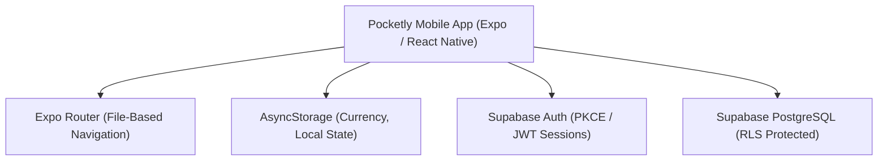

# 💰 Pocketly - Smart Daily Expense & Event Tracker

<div align="center">
  

  <h3>A modern, multi-currency mobile expense tracker with event-based budgeting.</h3>

  <p>
    <a href="#-key-features">Features</a> •
    <a href="#-architecture--tech-stack">Tech Stack</a> •
    <a href="#-getting-started">Getting Started</a> •
    <a href="#-database-setup">Database Setup</a> •
    <a href="#-project-structure">Project Structure</a> •
    <a href="#-license">License</a>
  </p>

  <p>
    
    
    
    
    
  </p>
</div>

---

## 📱 Overview

**Pocketly** is a cross-platform mobile expense tracking application designed for individuals, travelers, and event organizers. Built with **React Native**, **Expo Router**, **TypeScript**, and **Supabase**, Pocketly eliminates the friction of manual conversions with real-time multi-currency support, flexible event grouping, and time-based spending analytics.

---

## 🎯 Key Features

### 1. 💱 Multi-Currency Architecture
* **Supported Currencies:** `USD ($)`, `EUR (€)`, `GBP (£)`, and `PKR (Rs.)`.
* **Universal Normalization:** All expenses and events are automatically converted to and stored in base **USD** in the database, ensuring zero currency fragmentation.
* **Instant Currency Switcher:** One-tap currency switching that dynamically converts all past, present, and future amounts across all cards, filters, and forms.
* **Persistent Preferences:** The user's active currency selection is cached in `AsyncStorage` and restored across sessions.

### 2. 💸 Comprehensive Expense Tracking
* **Full CRUD Operations:** Add, view, edit, and delete transactions with instant state updates.
* **Categorization:** Built-in categories with custom visual emojis and color accents:
  * 🍔 **Food**
  * 🚗 **Transport**
  * 🛍️ **Shopping**
  * 💡 **Bills**
  * 🎬 **Entertainment**
  * 💊 **Health**
  * 📝 **Other**
* **Confirmation Safety:** Double-confirmation modals for additions and deletions to prevent accidental clicks.
* **Animated UI:** Smooth staggered card entry transitions powered by React Native Animated API.

### 3. 📅 Event-Based Expense Tracking
Group expenses by special occasions, trips, or home projects to track isolated budgets:
* ✈️ **Trip / Vacation** (Travel spending)
* 💍 **Wedding / Function** (Celebrations)
* 🏠 **Home Renovation** (Renovation milestones)
* 🛍️ **Shopping Spree** (Holiday & seasonal shopping)
* 🎂 **Birthday / Party** (Gatherings)
* 📋 **Custom Events** (Custom named occasions)
* **Real-time Event Search:** Filter and search through events on the fly.
* **Event Detail Screen:** Dedicated breakdowns showing total costs and item count per event.

### 4. 📊 Time-Based Summaries & Interactive Filtering
* **Total Expenses Card:** High-level overview of total cumulative spending.
* **Monthly Filter:** View spending for any month with an integrated 12-month picker.
* **Day-Level Precision:** Interactive calendar date picker (`@react-native-community/datetimepicker`) to drill down to specific dates.
* **Quick Reset:** One-click "Reset to Today" button to return to the current day's finances.

### 5. 🔐 User Authentication & Profile Management
* **Powered by Supabase Auth:** Secure user registration and login with email & password.
* **Deep-Linked Password Recovery:** Request reset emails with direct deep-link handling (`mydailyexpensenew://auth/reset-password`) using Supabase PKCE flow.
* **Interactive Onboarding:** 3-step swipeable visual tour for new users with gesture detection.
* **User Profile & Settings:**
  * Edit personal information (First Name, Last Name, and Email).
  * Dark / Light mode toggle switch.
  * Secure sign-out with confirmation prompt.

---

## 🛠️ Architecture & Tech Stack



| Layer | Technologies |
| :--- | :--- |
| **Framework** | [React Native](https://reactnative.dev/) (`0.81.5`) & [Expo](https://expo.dev/) (`~54.0.30`) |
| **Routing** | [Expo Router](https://docs.expo.dev/router/introduction/) (File-based tabs and stacks) |
| **Language** | [TypeScript](https://www.typescriptlang.org/) (`~5.9.2`) |
| **Backend & DB** | [Supabase](https://supabase.com/) (PostgreSQL with Row Level Security) |
| **State & Storage** | React Context API (`AuthContext`, `OnboardingContext`), `@react-native-async-storage/async-storage` |
| **Icons & Animation** | `@expo/vector-icons` (Ionicons), `react-native-reanimated` |

---

## 🚀 Getting Started

### Prerequisites
* [Node.js](https://nodejs.org/) (v18 or higher recommended)
* [Expo Go](https://expo.dev/go) app on iOS or Android device, OR configured Android Studio / Xcode simulators.
* A free [Supabase](https://supabase.com/) account.

### 1. Clone the Repository
```bash
git clone https://github.com/Hkmrkhan/pocketly.git
cd pocketly
```

### 2. Install Dependencies
```bash
npm install
```

### 3. Configure Environment Variables
Copy `.env.example` to `.env`:
```bash
cp .env.example .env
```
Update the `.env` file with your Supabase credentials:
```env
EXPO_PUBLIC_SUPABASE_URL=https://your-project.supabase.co
EXPO_PUBLIC_SUPABASE_ANON_KEY=your-supabase-anon-key
```

### 4. Run the Application
```bash
# Start Metro bundler
npx expo start

# Run on Android emulator / device
npx expo start --android

# Run on iOS simulator
npx expo start --ios

# Run on Web
npx expo start --web
```

---

## 🗄️ Database Setup

Run the included [`supabase-setup.sql`](./supabase-setup.sql) script in your Supabase SQL Editor:

1. Open your Supabase Dashboard -> **SQL Editor**.
2. Paste the contents of `supabase-setup.sql`.
3. Click **Run**.

### Schema Highlights:
* **`expenses` table**: Tracks daily transactions (`id`, `user_id`, `amount`, `description`, `category`, `created_at`, `updated_at`).
* **`events` table**: Tracks event transactions (`id`, `user_id`, `event_name`, `amount`, `event_date`, `created_at`, `updated_at`).
* **Row Level Security (RLS)**: Strictly restricts all `SELECT`, `INSERT`, `UPDATE`, and `DELETE` actions to `auth.uid() = user_id`.
* **Automatic Timestamps**: PostgreSQL triggers to maintain `updated_at` automatically.

---

## 📂 Project Structure

```text
mydailyexpense-new/
├── app/                        # Expo Router screen navigation
│   ├── (tabs)/                 # Bottom tab bar routes
│   │   ├── _layout.tsx         # Custom floating curved tab bar
│   │   ├── index.tsx           # Home expense tracking & dashboard
│   │   ├── events.tsx          # Events list & category search
│   │   ├── event-details.tsx   # Detailed category/event transactions
│   │   └── profile.tsx         # User profile, preferences, & settings
│   ├── auth/                   # Authentication routes
│   │   └── reset-password.tsx  # Deep-linked password recovery screen
│   ├── _layout.tsx             # Root app provider setup
│   └── modal.tsx               # Utility modal route
├── assets/                     # Images, icons, and fonts
├── components/                 # Reusable UI components
│   ├── auth/                   # LoginForm, SignupForm
│   ├── expense/                # ExpenseCard, ExpenseForm, ExpenseList, ExpenseSummary
│   └── onboarding/             # OnboardingScreen
├── contexts/                   # Global state providers (Auth, Onboarding)
├── lib/
│   ├── api/                    # Supabase API services (auth, expenses)
│   └── supabase.ts             # Supabase client initialization
├── types/                      # TypeScript database and form models
├── utils/                      # Currency, emoji, and date formatters
├── supabase-setup.sql          # Full database DDL, indexes, and RLS policies
└── app.json                    # Expo application configuration
```

---

## 🔒 Security Best Practices

* **Zero Sensitive Exposure:** Secrets and credentials are managed via environment variables and ignored by Git.
* **Database Isolation:** Database queries enforce user isolation through PostgreSQL RLS policies at the database layer.
* **PKCE Auth Flow:** Supabase authentication uses PKCE flow to protect tokens during deep-linking and browser handoffs.

---

## 👤 Author

Developed with ❤️ by **[Hkmrkhan](https://github.com/Hkmrkhan)**.

## 📄 License

This project is licensed under the MIT License - see the LICENSE file for details.
